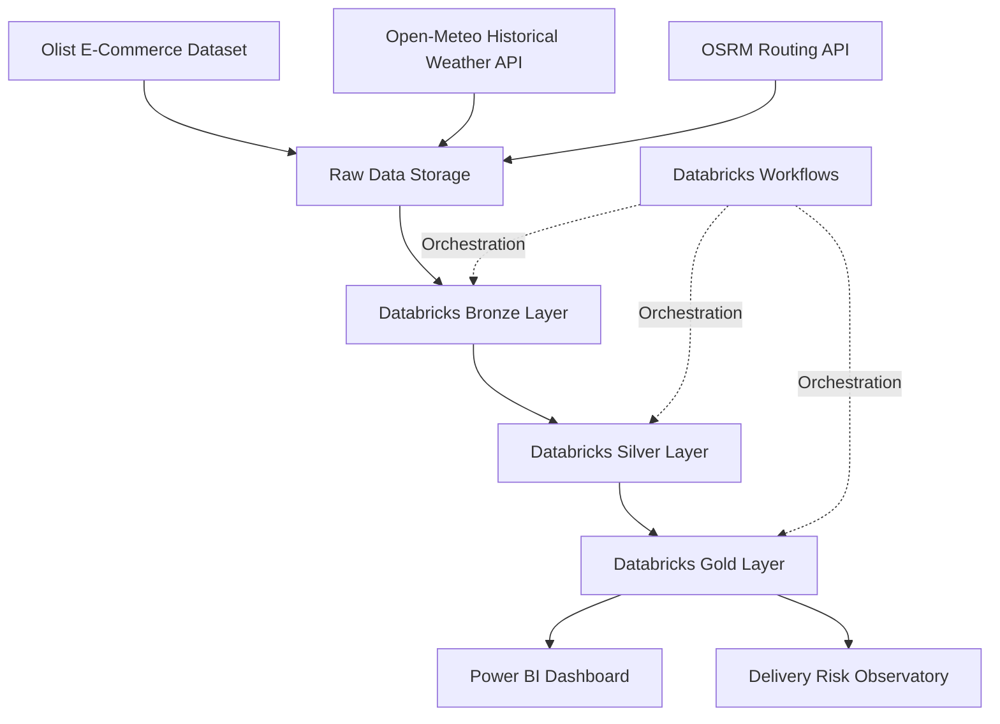

# LogiSense — Weather-Aware Supply Chain Intelligence

**An end-to-end data engineering and analytics platform for supply chain and delivery optimization.**

## 1. Project Overview

LogiSense is a multi-source data engineering project that analyzes historical e-commerce logistics data to identify delivery delays, evaluate seller performance, examine transportation patterns, and explore environmental factors associated with delivery outcomes.

The platform integrates e-commerce, historical weather, and road-routing data into a unified analytical pipeline. It transforms raw data through Bronze, Silver, and Gold layers and presents the resulting insights through an interactive Power BI dashboard.

## 2. Problem Statement

Supply chains generate large amounts of operational data, but understanding delivery performance requires combining information from multiple sources.

LogiSense addresses this challenge by:
- Measuring delivery performance across regions and time periods.
- Evaluating seller-level delivery reliability.
- Analyzing product categories, payment methods, and customer reviews.
- Exploring relationships between weather conditions and delivery outcomes.
- Examining estimated road distances between sellers and customers.
- Providing consolidated insights through an interactive dashboard.

## 3. System Architecture

## 4. Data Sources

### A. Olist Brazilian E-Commerce Dataset
- Source: [Kaggle — Brazilian E-Commerce Public Dataset by Olist](https://www.kaggle.com/datasets/olistbr/brazilian-ecommerce)
- Contains approximately 100,000 historical orders from Brazil.
- Includes customers, sellers, orders, payments, reviews, products, and geolocation information.
- Used as the primary source for logistics and delivery analysis.

### B. Open-Meteo Historical Weather API
- Source: [Open-Meteo Historical Weather API](https://open-meteo.com/en/docs/historical-weather-api)
- Provides historical temperature, precipitation, and wind-speed data.
- Weather information was collected for five major customer cities.
- Used to explore monthly weather conditions alongside delivery performance.

### C. OSRM Routing API
- Source: [Project OSRM Documentation](https://project-osrm.org/docs/v26.6.1/http)
- Uses OpenStreetMap road-network information.
- Provides estimated road distances and travel durations for selected seller-customer postal-code pairs.
- Used for exploratory transportation-distance analysis.

## 5. Technology Stack

| Component | Technology |
|---|---|
| Programming | Python |
| Data Processing | Apache Spark / PySpark |
| Data Platform | Databricks |
| Storage Format | Delta Lake |
| Raw Storage | Databricks Volumes |
| Data Sources | Kaggle, Open-Meteo, OSRM |
| Orchestration | Databricks Workflows |
| Visualization | Microsoft Power BI |
| Version Control | GitHub |

## 6. Data Engineering Pipeline

The project follows the Medallion Architecture.

### Bronze Layer — Raw Ingestion
- Ingests the Olist dataset and external API data.
- Preserves source data for downstream processing.
- Creates Bronze Delta tables.

### Silver Layer — Cleaning and Transformation
- Handles missing and invalid values.
- Removes duplicate records.
- Standardizes data types and formats.
- Derives delivery duration, delay, and performance indicators.
- Aggregates geolocation data into postal-code-level coordinates.
- Validates transformed datasets.

### Gold Layer — Analytics
Creates analytical tables for:
- Delivery performance
- Seller performance
- Product category performance
- Payment analysis
- Customer review analysis
- Weather and delivery analysis
- Route analysis
- State-level delivery performance
- Monthly delivery performance
- Unified Delivery Risk Observatory

## 7. Workflow Orchestration

The complete ETL pipeline is orchestrated using Databricks Workflows.

The workflow contains five notebook tasks:

1. `Logisense_Bronze` — Olist data ingestion.
2. `Logisense_Weather_Ingestion` — Weather API ingestion.
3. `Logisense_Routing_Ingestion` — OSRM route ingestion.
4. `Logisense_Silver` — Data cleaning and transformation.
5. `Logisense_Gold` — Analytical table generation.

The Silver transformation depends on all three ingestion tasks. Gold runs after Silver completes.

## 8. Power BI Dashboard

The interactive Power BI dashboard contains three analytical pages.

### Executive Overview
- Total orders and delivery KPIs.
- Monthly delivery trends.
- State-wise late delivery rates.
- Seller delivery reliability.
- Revenue by product category.

### Operational Intelligence
- Shipment distribution by route distance.
- Payment method distribution.
- Customer review score analysis.
- Estimated route distance versus travel time.
- Top 10 sellers by product revenue.

### Delivery Risk Observatory
- Temperature versus late delivery rate.
- Rainfall versus late delivery rate.
- Wind speed versus late delivery rate.
- Seller reliability sample coverage.
- Delivery performance breakdown.
- Interactive city and month filters.

## 9. Key Analytical Considerations

- The Olist dataset represents Brazilian e-commerce activity from 2016–2018. Findings should not be generalized directly to other countries.
- Weather analysis covers five major customer cities and uses purchase-month alignment. It identifies associations, not causal relationships between weather and individual delivery delays.
- OSRM provides estimated routes based on the present-day road network, not historical shipment routes or actual recorded travel times.
- Route analysis covers the 50 selected postal-code pairs, not every route in the dataset.
- Weather and route categories are exploratory analytical bands, not scientifically validated risk thresholds.
- The Delivery Risk Observatory is a descriptive, rule-based decision-support tool, not a machine-learning prediction model.
- Financial values are reported in Brazilian Real (BRL).

## 10. Repository Contents

The repository contains the exported Databricks notebooks, Power BI dashboard, and project documentation.

Expected project files:

- `Logisense_Bronze.py`
- `Logisense_Silver.py`
- `Logisense_Gold.py`
- `Logisense_Weather_Ingestion.py`
- `Logisense_Routing_Ingestion.py`
- `LogiSense_Dashboard.pbix`
- `LogiSense_Project_Report.docx`

## 11. Running the Project

1. Set up a Databricks workspace with Serverless compute.
2. Upload the required Olist dataset to a Databricks Volume.
3. Configure the raw storage paths in the notebooks if necessary.
4. Import the five exported notebooks into the Databricks workspace.
5. Configure the Databricks Workflow tasks and dependencies.
6. Execute the `LogiSense_End_to_End_ETL` workflow.
7. Connect Power BI Desktop to the resulting Gold tables to explore the dashboard.

The Olist dataset and external API data should be collected independently using the linked sources. Raw datasets are not included in this repository.

## 12. Future Scope

- Expand weather coverage to additional cities.
- Integrate live shipment tracking and logistics APIs.
- Improve route coverage beyond the selected postal-code pairs.
- Introduce predictive models for delivery-delay estimation.
- Add automated alerts for unusual delivery patterns.
- Extend the platform to additional countries and logistics datasets.

## 13. Project Information

**Project:** LogiSense — Weather-Aware Supply Chain Intelligence  
**Category:** Data Engineering and Business Intelligence  
**Repository:** [GitHub — databricks-project](https://github.com/aryan30-tp/databricks-project)

---

*Developed as an academic team project demonstrating multi-source data ingestion, distributed data processing, ETL orchestration, analytical modeling, and business intelligence visualization.*
